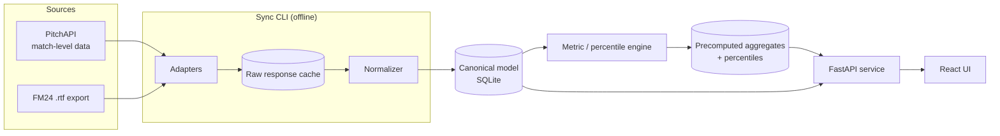

# Soccer + FM Scouting Tool

A scouting and comparison tool with two modes that share one core:

- **Real-world scouting.** Search players and teams, view their stats in several layouts, chart them (radar, bars, scatter), and compare players on metrics you choose. Percentiles are always computed against an explicit peer group.
- **Football Manager scouting.** Import an FM24 `.rtf` player-view export, then compare FM players with each other, or with real-world players through an explicit comparability layer.

> **Status: Phase 0 (spike + foundations).** Nothing runs yet. The roadmap is in [`docs/PLAN.md`](docs/PLAN.md) and the reasoning behind decisions is in [`DECISIONS.md`](DECISIONS.md).

---

## Contents

- [Features](#features)
- [How it works](#how-it-works)
- [Tech stack](#tech-stack)
- [Repository layout](#repository-layout)
- [Getting started](#getting-started)
- [Environment variables](#environment-variables)
- [Syncing data](#syncing-data)
- [Data principles](#data-principles)
- [Roadmap](#roadmap)
- [Data sources and disclaimers](#data-sources-and-disclaimers)
- [License](#license)

---

## Features

### MVP (real-world, top 5 leagues)
- [ ] Fuzzy player search that handles accents and abbreviations (`E. Haaland`, `Odegaard`), filterable by league, season, team, position and minutes
- [ ] Player page: summary card, full stat table, per-90/totals toggle, season selector
- [ ] Percentile radar using position-specific metric templates
- [ ] Bar charts and a scatterplot of any two metrics, with peer-group context and labeled outliers
- [ ] Comparison of 2+ players, with preset metric packages (striker, winger, CM, CB, fullback, GK)

### After the MVP
- [ ] More leagues (Eredivisie, Liga Portugal, MLS, Saudi Pro League, …) and team pages
- [ ] FM24 `.rtf` import with dynamic header mapping and dated snapshots
- [ ] FM ↔ real-world comparison with per-metric comparability flags
- [ ] Shot maps, heatmaps, pass networks, form and trend lines
- [ ] Stretch goal: research whether `.fm` save files can be imported

## How it works

The web app **never calls the external API**. A separate sync CLI crawls PitchAPI, caches raw responses, and normalizes everything into one canonical model. The API and UI only ever read from the local database.



Layers: **adapters → normalization + storage → metric engine → API → UI**. Adapters can be swapped, and charts and comparisons only ever read the canonical model.

PitchAPI has no player search and no season totals, because its data is match-level only. So the search index, the season aggregates and the per-90 rates are all built here, from per-match data.

## Tech stack

| Layer | Choice |
|---|---|
| Backend | Python 3.12, [uv](https://docs.astral.sh/uv/), FastAPI, Pydantic v2 |
| Database | SQLite with SQLAlchemy 2.0 + Alembic (schema stays portable to Postgres) |
| Stats | pandas |
| Search | SQLite FTS5 + rapidfuzz + unidecode |
| Sync jobs | Typer CLI |
| Frontend | Vite + React + TypeScript (strict), TanStack Query |
| Charts | Chosen in Phase 4 |
| Tests | pytest + hypothesis, Vitest |
| Lint / types | ruff, mypy `--strict`, ESLint, Prettier |

## Repository layout

Layer rules and dependency rules are in [`docs/ARCHITECTURE.md`](docs/ARCHITECTURE.md).

```
.
├── backend/
│   ├── src/scouting/
│   │   ├── config/        # Settings from environment
│   │   ├── domain/        # Canonical model (no I/O)
│   │   ├── adapters/      # Layer 1: pitchapi/, fm/
│   │   ├── db/            # Layer 2: tables, sessions, upserts
│   │   ├── ingest/        # Layer 2: normalization + sync state
│   │   ├── metrics/       # Layer 3: registry, per-90, peer groups, percentiles
│   │   ├── mappings/      # YAML: FM header map, comparability, position templates
│   │   ├── api/           # Layer 4: FastAPI
│   │   └── cli/           # Typer entry points
│   ├── migrations/        # Alembic
│   ├── scripts/           # One-off scripts (Phase 0 spike)
│   └── tests/             # unit/, integration/, fixtures/
├── frontend/              # Layer 5: Vite + React (created in Phase 3/4)
├── docs/
│   ├── PLAN.md            # Roadmap, phases, open questions
│   ├── ARCHITECTURE.md    # Layers and dependency rules
│   └── PITCHAPI_NOTES.md  # Verified API facts and gotchas
├── data/                  # Local SQLite DB + spike output (gitignored)
├── DECISIONS.md           # Decision log
├── CLAUDE.md              # Working rules for AI-assisted development
├── MEMORY.md              # Session-to-session progress log
├── ERRORS.md              # Approaches that failed and what worked
└── .env.example
```

## Getting started

### Prerequisites
- Python 3.12
- [uv](https://docs.astral.sh/uv/getting-started/installation/)
- Node.js (current LTS) and npm
- A PitchAPI key from [pitchapi.dev](https://pitchapi.dev/)

### Setup

```bash
git clone <this-repo-url>
cd <repo>
cp .env.example .env      # then fill in PITCHAPI_API_KEY
```

Backend and frontend setup commands will be added here once the scaffolding lands in Phase 0.

## Environment variables

Defined in [`.env.example`](.env.example). Copy it to `.env`, which is gitignored.

| Variable | Required | Default | Purpose |
|---|---|---|---|
| `PITCHAPI_API_KEY` | Yes (sync only) | — | PitchAPI key. Server-side only; never used by the frontend |
| `DATABASE_URL` | No | `sqlite:///data/scouting.db` | SQLAlchemy database URL |
| `SYNC_MAX_RPS` | No | `1` | Throttle for the sync CLI, in requests/second |
| `LOG_LEVEL` | No | `INFO` | Log verbosity |

The API key must never be committed, logged, or sent to the browser.

## Syncing data

The CLI commands are still to be decided and arrive in Phase 1. Planned behaviour:

- **Idempotent.** Re-running a sync upserts and never duplicates.
- **Resumable.** An interrupted crawl continues from where it stopped.
- **Incremental.** Each league and season tracks when it was last synced. Finished matches are fetched once and never again.
- **Polite.** Requests are throttled, and the CLI backs off on `429` and honours `Retry-After`.

Crawl order: EPL 2025-26 first, then the rest of EPL back to the earliest available season, then La Liga, Bundesliga, Serie A and Ligue 1.

## Data principles

- **Provenance on everything.** Every stat and chart shows its source, season, minutes and sample size.
- **Null is not zero.** Missing data stays missing in storage, maths and charts.
- **Model outputs are labeled.** xG, xT and VAEP are flagged as model outputs, as opposed to counted events.
- **Explicit peer groups.** Percentiles are computed within the same position, league and season, above a minimum-minutes threshold. The peer group and its size are always shown, with a warning when the sample is small.
- **No silent cross-source comparisons.** FM ↔ real-world metrics carry a flag: `direct`, `approximate` or `not comparable`.
- **Coverage gaps are shown.** Leagues without ratings and matches without advanced analytics are flagged in the UI instead of showing as blanks.
- **No fabricated data.** Mock data only ever appears as clearly labeled fixtures.

## Roadmap

| Phase | Scope |
|---|---|
| 0 | Spike + foundations |
| 1 | Ingestion slice: EPL, one season |
| 2 | Aggregation + metric/percentile engine |
| 3 | Backend API |
| 4 | **MVP UI** |
| 5 | More leagues and seasons, coverage, team pages |
| 6 | FM24 `.rtf` import |
| 7 | FM ↔ real-world comparability |
| 8 | Shot maps, heatmaps, pass networks, trends |
| 9 | Polish |

Exit criteria and estimates for each phase are in [`docs/PLAN.md`](docs/PLAN.md).

## Data sources and disclaimers

- Real-world match data comes from [PitchAPI](https://pitchapi.dev/). Metric definitions such as xG, xT, PPDA and field tilt are PitchAPI's own, and they aren't comparable with other providers' versions.
- This project is not affiliated with or endorsed by PitchAPI, Sports Interactive or SEGA. *Football Manager* and related marks belong to their respective owners.
- No Football Manager game files or save files are included in this repository.
- PitchAPI's terms for caching and redistributing its data haven't been confirmed yet. They will be checked before any public deployment (see `DECISIONS.md` D-007).

## License

To be decided. The code license won't cover third-party data: PitchAPI data stays subject to PitchAPI's own terms.
