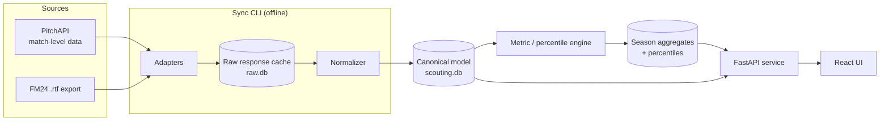

# Soccer + FM Scouting Tool

A scouting and comparison tool with two modes that share one core:

- **Real-world scouting.** Search players and teams, view their stats in several layouts, chart them (radar, bars, scatter), and compare players on metrics you choose. Percentiles are always computed against an explicit peer group.
- **Football Manager scouting.** Import an FM24 `.rtf` player-view export, then compare FM players with each other, or with real-world players through an explicit comparability layer.

> **Status: Phase 3 done (2026-11-22); Phase 4 (MVP UI) is next.** The backend crawls PitchAPI, stores one season (EPL 2025/26), builds season aggregates, peer groups (with 6s and 8s split by heatmap depth), percentiles and position templates, and serves them through a read-only local API (search, player pages, radars, peer groups, comparisons). There's no UI yet. The roadmap is in [`docs/PLAN.md`](docs/PLAN.md) and the reasoning behind decisions is in [`DECISIONS.md`](DECISIONS.md).

---

## Contents

- [Features](#features)
- [How it works](#how-it-works)
- [Tech stack](#tech-stack)
- [Repository layout](#repository-layout)
- [Getting started](#getting-started)
- [Environment variables](#environment-variables)
- [Syncing data](#syncing-data)
- [Aggregates, peer groups and percentiles](#aggregates-peer-groups-and-percentiles)
- [Position templates](#position-templates)
- [Inspecting and reporting](#inspecting-and-reporting)
- [When to re-run what](#when-to-re-run-what)
- [Using the API](#using-the-api)
- [Tests and checks](#tests-and-checks)
- [Data principles](#data-principles)
- [Roadmap](#roadmap)
- [Data sources and disclaimers](#data-sources-and-disclaimers)
- [License](#license)

---

## Features

### MVP (real-world, top 5 leagues)
- [ ] Fuzzy player search that handles accents and abbreviations (`E. Haaland`, `Odegaard`), filterable by league, season, team, position and minutes (API done; the UI comes in Phase 4)
- [ ] Player page: summary card, full stat table, per-90/totals toggle, season selector
- [ ] Percentile radar using position-specific metric templates (templates and the API: done; the chart comes in Phase 4)
- [ ] Bar charts and a scatterplot of any two metrics, with peer-group context and labeled outliers
- [ ] Comparison of 2+ players, with preset metric packages per position

### After the MVP
- [ ] More leagues (Eredivisie, Liga Portugal, MLS, Saudi Pro League, …) and team pages
- [ ] FM24 `.rtf` import with dynamic header mapping and dated snapshots
- [ ] FM ↔ real-world comparison with per-metric comparability flags
- [ ] Custom (user-edited) templates, cross-position templates, weighted scores
- [ ] Shot maps, heatmaps, pass networks, form and trend lines
- [ ] Stretch goal: research whether `.fm` save files can be imported

## How it works

The web app **never calls the external API**. A separate sync CLI crawls PitchAPI, caches raw responses, and normalizes everything into one canonical model. The API and UI only ever read from the local database.



Layers: **adapters → normalization + storage → metric engine → API → UI**. Adapters can be swapped, and charts and comparisons only ever read the canonical model.

PitchAPI has no player search and no season totals, because its data is match-level only. So the search index, the season aggregates and the per-90 rates are all built here, from per-match data.

## Tech stack

| Layer | Choice |
|---|---|
| Backend | Python 3.12, [uv](https://docs.astral.sh/uv/), Pydantic v2 |
| API | FastAPI + uvicorn, read-only, local only (`scouting serve`) |
| Database | SQLite with SQLAlchemy 2.1 + Alembic (schema stays portable to Postgres); `raw.db` with stdlib `sqlite3` |
| Stats | SQL aggregation + plain Python percentiles |
| Search | rapidfuzz + unidecode, an in-memory index per season |
| Sync jobs | Typer CLI `scouting` |
| Config files | TOML (position templates now; the FM header map in Phase 6) |
| Frontend | Vite + React + TypeScript (strict), TanStack Query (Phase 4) |
| Charts | Chosen in Phase 4 |
| Tests | pytest + hypothesis, Vitest |
| Lint / types | ruff, mypy `--strict`, ESLint, Prettier |

## Repository layout

Layer rules and dependency rules are in [`docs/ARCHITECTURE.md`](docs/ARCHITECTURE.md).

```
.
├── backend/
│   ├── src/scouting/
│   │   ├── config/        # Settings from environment
│   │   ├── domain/        # Positions, formations, names (no I/O)
│   │   ├── adapters/      # Layer 1: pitchapi/ (client, cache, raw.db, parsers); fm/ later
│   │   ├── db/            # Layer 2: tables, queries, reports, data checks
│   │   ├── ingest/        # Layer 2: match list, match detail, season sync, profiles
│   │   ├── metrics/       # Layer 3: registry, aggregation, 6/8 depth split, percentiles, templates
│   │   ├── mappings/      # TOML: position templates (FM header map, comparability later)
│   │   ├── api/           # Layer 4: FastAPI app, routes, response models, search
│   │   └── cli/           # Typer entry points
│   ├── migrations/        # Alembic
│   ├── scripts/           # Read-only data checks and one-off reports
│   ├── spikes/            # API exploration scripts (their data stays out of git)
│   └── tests/             # unit/, integration/, fixtures/
├── frontend/              # Layer 5: Vite + React (Phase 4)
├── docs/
│   ├── PLAN.md            # Roadmap, phases, open questions
│   ├── ARCHITECTURE.md    # Layers and dependency rules
│   └── PITCHAPI_NOTES.md  # Verified API facts and gotchas
├── DECISIONS.md           # Decision log
├── CLAUDE.md              # Working rules for AI-assisted development
├── MEMORY.md              # Session-to-session progress log
├── ERRORS.md              # Approaches that failed and what worked
└── .env.example
```

## Getting started

### Prerequisites
- Python 3.12
- [uv](https://docs.astral.sh/uv/getting-started/installation/)
- A PitchAPI key from [pitchapi.dev](https://pitchapi.dev/) (only for online syncs)
- Keep the repo out of iCloud-synced folders: hidden `.pth` files break the editable install (ERRORS.md)

### Setup

From the repo root, copy `.env.example` to `.env` and fill in `PITCHAPI_API_KEY`:

```bash
cp .env.example .env
```

Then install the backend and create the database:

```bash
cd backend
uv sync
uv run alembic upgrade head
```

Every `scouting` command below runs from `backend/`.

## Environment variables

Defined in [`.env.example`](.env.example). Copy it to `.env` in the repo root, which is gitignored.

| Variable | Required | Default | Purpose |
|---|---|---|---|
| `PITCHAPI_API_KEY` | Online syncs only | — | PitchAPI key. Server-side only; never used by the frontend |
| `DATABASE_URL` | No | `sqlite:///data/scouting.db` | SQLAlchemy URL of the canonical database |
| `RAW_DB_PATH` | No | `data/raw.db` | The raw response cache |
| `SYNC_MAX_RPS` | No | `1` | Throttle for the sync CLI, in requests/second (max 5) |
| `LOG_LEVEL` | No | `INFO` | Log verbosity (`ERROR` keeps long syncs quiet) |

The API key must never be committed, logged, or sent to the browser. `backend/data/` holds both databases and is gitignored: PitchAPI's terms for redistributing its data aren't confirmed (D-007).

## Syncing data

A first full season (about 2,060 requests at 1 per second, ~35 minutes):

```bash
LOG_LEVEL=ERROR uv run scouting sync season --league l_4WFCIZ --season 2025/2026
```

- **Four requests per match:** players, advanced analytics, lineups, heatmaps. Finished matches are never fetched again; profiles are fetched once per player.
- **Idempotent and resumable.** Re-running upserts and never duplicates; Ctrl-C loses at most the match in progress. `--limit N` processes N matches and stops.
- **Offline.** `--offline` uses only `raw.db`; with `--renormalize` it re-processes every match from cache (no requests). Heatmaps never fetched stay `pending`, which doesn't block anything.
- **Polite.** Requests are throttled, `429`s back off and honour `Retry-After`, and 404s like `ANALYTICS_UNAVAILABLE` are cached as results.
- A sync that leaves nothing pending rebuilds the aggregates automatically.

Other sync commands: `sync matches` (match list only), `sync match` (one match), `sync profiles`.

## Aggregates, peer groups and percentiles

```bash
uv run scouting aggregate --league l_4WFCIZ --season 2025/2026
```

- **Season stats** per player: totals, per-90s (on `/players` minutes, a full match = 90), success rates as Σ successes ÷ Σ attempts, exposure minutes per metric (a match without advanced analytics adds no minutes to advanced metrics). Null is never treated as 0 unless the registry says so from evidence.
- **Roles and peer groups:** GK, CB, FB, DM, CM, AM, W, ST, from the formation slot each player started in most. Central midfielders are split into **6s (DM) and 8s (CM) by heatmap depth**: less than 14 m in front of their own centre-backs (season average over their central-midfield starts) is a 6, unless their deepest midfield partner plays at least 2 m deeper (then an 8). Fewer than 5 starts with heatmaps falls back to the formation (a lone holding midfielder is a 6). Details: DECISIONS D-017, D-018.
- **Percentiles** within the peer group (same league, season and role, at least 25% of the possible minutes: 855 for a full EPL season), midpoint formula. Success rates also need a minimum number of attempts (e.g. 100 passes). Groups under 20 players get a warning.
- **Volume next to rates:** passes, crosses, dribbles, long balls and aerials are ranked both on success rate and on successes per 90.

## Position templates

`backend/src/scouting/mappings/position_templates.toml` holds one template per peer role (about 12 process metrics in sections; 8 for keepers). They drive the radar, the comparison presets and the FM metric wishlist. Outcomes (goals, assists, …) are kept off templates and shown elsewhere. A test fails if a built-in template breaks a rule (unknown metric, wrong position, outcome, near-duplicate pair, size outside 8–14).

## Inspecting and reporting

```bash
uv run scouting inspect player salah --league l_4WFCIZ --season 2025/2026 --template
```

- `inspect player NAME_OR_ID` — a player's season (`--metric CODE`, `--matches` for per-match values, `--template` for his position template with percentiles)
- `inspect appearance --match M --player P` — one appearance, stored vs raw values
- `report peers --role ST --metric npxg` — a peer group's ranking on one metric
- `report thresholds` — who the minimum attempts leave out, per group
- `report depth` — the 6/8 calibration (`--all` lists every central midfielder)
- `report templates` — checks the templates against the season
- `report formations` — formations and unmapped slots
- `report checksum` — a hash of every table, to confirm a rebuild changed nothing

Read-only scripts in `backend/scripts/` (`check_2c.py`, `check_2e.py`, `template_options.py`) answer data questions; their results are recorded in DECISIONS.md.

## When to re-run what

| You changed | Run |
|---|---|
| A registry value (`season_null`, minimum attempts, a volume metric) or the 6/8 rule | `scouting aggregate` |
| A formation mapping or an absence policy | `scouting sync season --offline --renormalize` (re-aggregates) |
| A new endpoint or a new season | `scouting sync season` online (fetches only what's missing) |
| A model (table or column) | `uv run alembic revision --autogenerate -m "…"`, check it, then `alembic upgrade head` |

On SQLite, use plain string server defaults and never add or change a CHECK on a table other tables reference: the rebuild fails (ERRORS.md). Derived tables can be dropped and recreated instead.

## Using the API

```bash
uv run scouting serve
```

The API runs on `http://127.0.0.1:8000/api/v1` (localhost only). **The full reference is generated from the code at [`/docs`](http://127.0.0.1:8000/docs)**: every endpoint, parameter and response field, with a "Try it out" button. The API only reads `scouting.db` (opened read-only) and never calls PitchAPI. After `scouting aggregate` there's nothing to restart; after a migration, restart it.

**Concepts**
- **Scope key:** every data endpoint takes `scope=`, one league-season, e.g. `l_4WFCIZ.2025-2026` (listed by `/scopes`). Players are addressed by their PitchAPI ID (`p_1reWwN`).
- **Null is not zero:** `null` means no data; per-match lists keep appearances without data as `null`.
- **Percentiles** are 0–100 within a peer group, stored raw (low value = low percentile; use `direction` to flip lower-is-better metrics). Every one comes with the group (`role`, `size`, `min_minutes`, `small_sample`) and `ranked_among`; a missing one comes with a `reason`.
- **`rate_scale`:** success rates are a 0–1 share; averaged keeper rates are percent (0–100) or metres.
- **`min_minutes=`** (90 or more) ranks within a group at another threshold, computed per request: responses say `stored: false`.
- **`outside_group: true`** (in `/compare`): the player is ranked against a group he isn't in (another role, or under its minutes) without being added to it, so nobody else's percentile changes.

**Endpoints** (all `GET`)

| Endpoint | What it returns |
|---|---|
| `/health` | Status and schema version |
| `/scopes`, `/scopes/{key}` | Seasons available, with coverage and peer groups |
| `/metrics`, `/metrics/{code}` | The metric registry |
| `/templates`, `/templates/{id}` | The position templates |
| `/players/search?q=` | Fuzzy name search (accents, initials), filters `team`, `role`, `min_minutes` |
| `/players/{id}` | Player card: teams, roles, 6/8 split, rating, peer group, coverage |
| `/players/{id}/stats` | Full stat table (or `metrics=a,b`) |
| `/players/{id}/matches?metric=` | One metric per appearance, for form and trend lines |
| `/players/{id}/template` | Radar data through his position template (or `template=ST`) |
| `/groups/{role}` | Every member of a peer group on chosen metrics, for rankings, bars and scatters |
| `/compare?players=a,b` | 2–6 players side by side, each in his own group or all `against=ROLE` |

**Errors** use one shape, `{"error": {"code": "PLAYER_NOT_FOUND", "message": "…"}}`; branch on `code`. Bad parameters are `400 BAD_REQUEST`; a season without aggregates is `409 SCOPE_NOT_AGGREGATED`; an out-of-date database is `503 SCHEMA_OUT_OF_DATE`.

**The contract** is the committed OpenAPI file `backend/tests/unit/api/openapi.json`; a test fails when the API changes shape. After a deliberate change, regenerate it and review the diff:

```bash
UPDATE_OPENAPI=1 uv run pytest tests/unit/api/test_api_meta.py -k openapi
```

## Tests and checks

```bash
uv run pytest -q
uv run mypy src tests
uv run ruff check src tests
```

The tests use a hand-made three-match fixture season (`tests/fixtures/pitchapi/`); spike integration tests run only where the spike data exists.

## Data principles

- **Provenance on everything.** Every stat and chart shows its source, season, minutes and sample size.
- **Null is not zero.** Missing data stays missing in storage, maths and charts.
- **Model outputs are labeled.** xG, xT and VAEP are flagged as model outputs, as opposed to counted events.
- **Explicit peer groups.** Percentiles are computed within the same position, league and season, above a minimum-minutes threshold. The peer group and its size are always shown, with a warning when the sample is small.
- **No silent cross-source comparisons.** FM ↔ real-world metrics carry a flag: `direct`, `approximate` or `not comparable`.
- **Coverage gaps are shown.** Leagues without ratings and matches without advanced analytics are flagged in the UI instead of showing as blanks.
- **No fabricated data.** Mock data only ever appears as clearly labeled fixtures.

## Roadmap

| Phase | Scope | Status |
|---|---|---|
| 0 | Spike + foundations | Done |
| 1 | Ingestion slice: EPL, one season | Done |
| 2 | Aggregation + metric/percentile engine, 6/8 split, position templates | Done |
| 3 | Backend API | Done |
| 4 | **MVP UI** | Next |
| 5 | More leagues and seasons, coverage, team pages | |
| 6 | FM24 `.rtf` import | |
| 7 | FM ↔ real-world comparability | |
| 8 | Shot maps, heatmaps, pass networks, trends | |
| 9 | Polish | |

Exit criteria and estimates for each phase are in [`docs/PLAN.md`](docs/PLAN.md).

## Data sources and disclaimers

- Real-world match data comes from [PitchAPI](https://pitchapi.dev/). Metric definitions such as xG, xT, PPDA and field tilt are PitchAPI's own, and they aren't comparable with other providers' versions.
- This project is not affiliated with or endorsed by PitchAPI, Sports Interactive or SEGA. *Football Manager* and related marks belong to their respective owners.
- No Football Manager game files or save files are included in this repository.
- PitchAPI's terms for caching and redistributing its data haven't been confirmed yet. They will be checked before any public deployment (see `DECISIONS.md` D-007).

## License

To be decided. The code license won't cover third-party data: PitchAPI data stays subject to PitchAPI's own terms.
